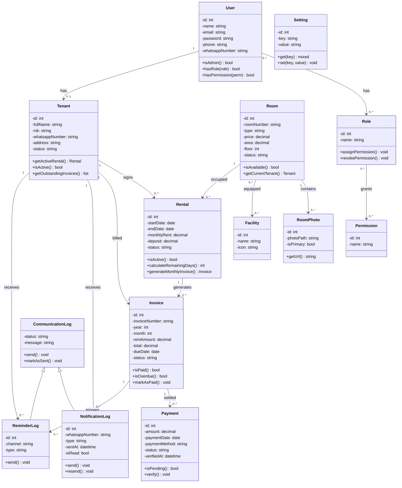

# SiManKos - Class Diagram



## 📋 Rincian Domain

### 1. Domain Manajemen Pengguna
- **User**: Admin, Staff, Penghuni
- **Role**: Admin, Staff, Tenant (RBAC Spatie)
- **Permission**: Buat, Edit, Hapus, Lihat

### 2. Domain Manajemen Kamar
- **Room**: Kamar kos dengan tipe (Basic, Standard, Deluxe)
- **Facility**: Fasilitas kamar (AC, WiFi, Kamar Mandi Pribadi, dll)
- **RoomPhoto**: Foto kamar dengan penunjukan utama

### 3. Domain Manajemen Penyewa
- **Tenant**: Profil penyewa dengan NIK, kontak darurat, preferensi notifikasi

### 4. Domain Manajemen Kontrak
- **Rental**: Kontrak sewa dengan durasi, sewa bulanan, deposit

### 5. Domain Manajemen Keuangan
- **Invoice**: Tagihan bulanan dengan pelacakan pembayaran
- **Payment**: Transaksi pembayaran dengan verifikasi admin

### 6. Domain Komunikasi
- **CommunicationLog**: Kelas dasar abstrak
- **NotificationLog**: Notifikasi WhatsApp real-time
- **ReminderLog**: Pengingat tagihan terjadwal

---

## 🔄 Alur Bisnis Utama

```
Pengguna (Akun)
    ↓
Penyewa (Profil)
    ↓
Kontrak Sewa (Rental)
    ↓
Tagihan (Invoice)
    ↓
Pembayaran (Payment)
    ↓
Log Komunikasi
├─ Notifikasi
└─ Pengingat
```

---

## 📊 Hubungan Kunci

| Dari | Ke | Tipe | Kardinalitas |
|------|-----|------|-------------|
| User | Role | Asosiasi | M:M |
| Role | Permission | Asosiasi | M:M |
| Room | RoomPhoto | Komposisi | 1:N |
| Room | Facility | Asosiasi | M:M |
| Tenant | Rental | Asosiasi | 1:N |
| Room | Rental | Asosiasi | 1:N |
| Rental | Invoice | Asosiasi | 1:N |
| Invoice | Payment | Asosiasi | 1:N |
| CommunicationLog | NotificationLog | Inheritance | - |
| CommunicationLog | ReminderLog | Inheritance | - |
